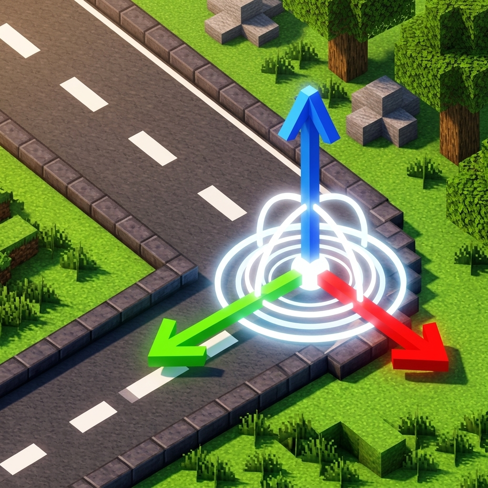

# EasyRoads (Road Builder)

<div align="center">



**Intuitive, smooth, and procedural 3D road construction for Minecraft.**

[](https://minecraft.net/)
[](https://neoforged.net/)
[](https://github.com/kirichVRX/EasyRoads)
[](TEMPLATE_LICENSE.txt)

> 📖 **[Перейти на русскую версию / Switch to Russian (README_RU.md)](README_RU.md)**

[Features](#-features) • [Controls & Keybinds](#-controls--keybinds) • [Commands](#-commands) • [Preset Studio](#-road-preset-studio) • [Building from Source](#-building-from-source)

</div>

---

> [!WARNING]
> **Alpha Testing Stage**: EasyRoads is currently in active alpha testing. Some features may change, and you might encounter bugs. Please back up your worlds and report any issues on the [GitHub Issues](https://github.com/kirichVRX/EasyRoads/issues) page!

---

## 🌟 Overview

**EasyRoads** revolutionizes road construction in Minecraft. Say goodbye to tedious block-by-block placement or rigid straight lines! With EasyRoads, you can design natural, curving highways, city streets, mountain serpentines, and rural paths using smooth **3D Bézier curves** and an interactive in-game editor.

Preview your roads in real time with interactive 3D gizmos, tweak slopes and turns, configure custom cross-sections and multi-layered road profiles, and generate the entire road with a single keystroke.

---

## ✨ Features

- 🛣️ **3D Bézier Curve Geometry**: Create natural bends, smooth highway turns, and clean elevation transitions without jagged step artifacts.
- 🎯 **Interactive In-Game Editor (Edit Mode)**:
  - **Add Tool**: Click anywhere in the world to plant road anchor nodes.
  - **Select Tool**: Select existing nodes to inspect and modify them.
  - **Adjust Tool**: Move nodes with precision in 3D (vertical elevation via Mouse Wheel, horizontal alignment via Arrow keys or WASD).
  - **Delete Tool**: Remove unwanted points on the fly.
- 👁️ **Real-Time 3D Gizmo Preview**: See the exact curve trajectory, width, and banking before placing a single block.
- 🎨 **Road Preset Studio**:
  - Configure multi-layer profiles (surface asphalt, sub-base gravel, curbs, sidewalks, and markings).
  - Save and switch between road styles instantly.
- ↩️ **Terrain-Safe Undo System**: Made a mistake or placed a road in the wrong spot? One command safely restores the previous terrain without leaving rogue blocks.
- ⚡ **Optimized Server-Side Voxelization**: Fast block placement engine designed to keep server TPS smooth and responsive.

---

## 🎮 Controls & Keybinds

All keybindings can be customized in Minecraft's standard **Options $\rightarrow$ Controls $\rightarrow$ Key Binds**:

| Key | Default | Description |
| :--- | :---: | :--- |
| **Toggle Edit Mode** | `F7` | Enter / Exit road construction mode |
| **Open Preset Studio** | `Caps Lock` | Open GUI to choose and customize road styles |
| **Build Road (Finalize)** | `Enter` | Voxelize the active preview curve into blocks |
| **Place Anchor Node** | `Left Click` | Place a new point on the ground (in Add mode) |
| **Vertical Height (Y)** | `Mouse Wheel` | Adjust elevation of selected node (in Adjust mode) |
| **Horizontal Move (XZ)** | `Arrow Keys` / `WASD` | Fine-tune node position horizontally |

---

## ⌨️ Commands

| Command | Permission | Description |
| :--- | :---: | :--- |
| `/road undo` | OP (Level 2) | Reverts the last placed road segment and restores terrain |
| `/road clear` | OP (Level 2) | Clears active road graph and preview nodes |
| `/road stats` | OP (Level 2) | Displays statistics of the current road network graph |
| `/road test` | OP (Level 2) | Spawns a test road segment for debugging |

---

## 🛠️ Road Preset Studio

Press `Caps Lock` while in-game to open the **Road Preset Studio**. From here, you can:
- Select between different road styles (e.g., Highway, City Avenue, Country Path).
- Define surface width and sidewalk width.
- Choose block palettes for the road foundation, pavement, lines, and borders.

---

## 💻 Building from Source

### Prerequisites
- **Java 21** or higher
- **Git**

### Build Instructions
Clone the repository and compile the mod with Gradle:

```bash
git clone https://github.com/kirichVRX/EasyRoads.git
cd EasyRoads

# On Windows:
.\gradlew build

# On Linux / macOS:
./gradlew build
```

The compiled mod JAR will be located in `build/libs/`.

---

## 📜 License & Credits

Developed by **kirichVRX**. Built for **Minecraft NeoForge**.
Contributions, bug reports, and suggestions are welcome via [GitHub Issues](https://github.com/kirichVRX/EasyRoads/issues)!
